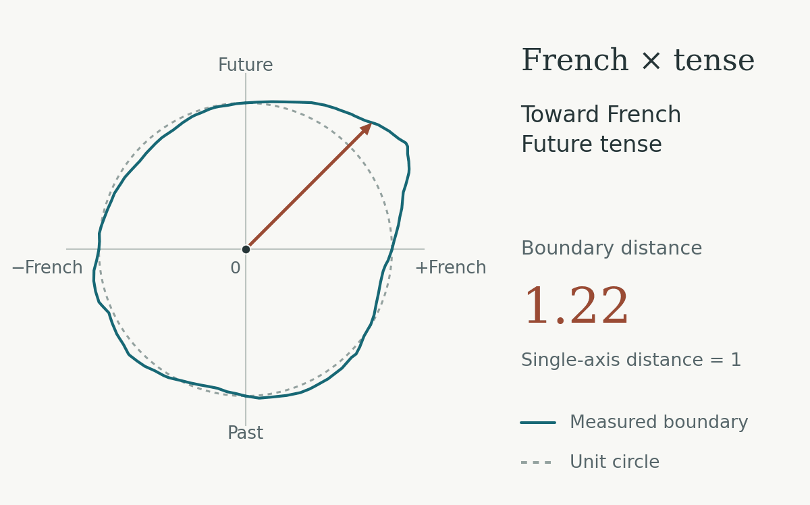
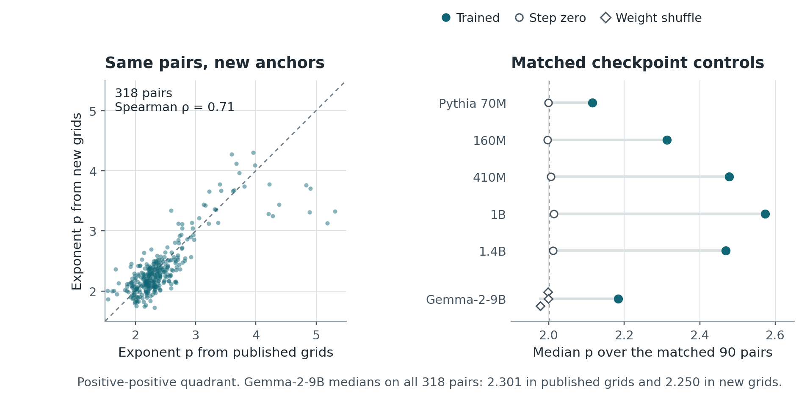
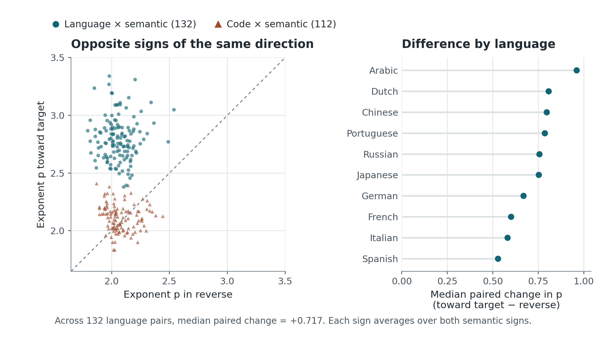
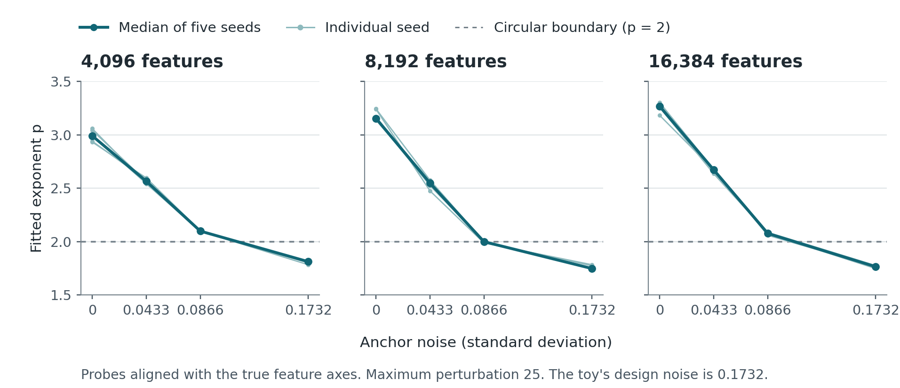

# Revisiting feature-specific error correction

Francisco Ferreira da Silva and Stefan Heimersheim asked how large a change inside a language model it takes to produce a given change at a later layer. We repeated their main Gemma-2-9B measurement and explored what happens when one part of the push points the other way. [Paper](https://arxiv.org/abs/2606.24964) · [Authors’ code and data](https://github.com/FranciscoHS/fsec-paper/tree/a9355d4001500708a40a255bacfe559e6dc269c0)

[**Explore the four quadrants ↗**](https://weiyuech.github.io/fsec-geometry/) · [What we reproduced](#what-we-reproduced) · [What we added](#what-we-added)

## What is being pushed?

As Gemma reads a text, it passes a list of numbers for each token from layer to layer. The current values in that list are its *residual-stream activation*. We run the same text twice. On the second run, we turn the last token’s list slightly in a chosen direction at an early layer, keeping its overall length fixed. Near the end of each run, we compare the two lists and measure how far apart they are. [Paper, methods](https://arxiv.org/html/2606.24964v1#S3)

  

The center means **no push**. Right is the direction the researchers estimated by comparing English sentences with their French translations. Up is the direction they estimated by comparing past-tense sentences with future-tense ones. **↗ is a single change with both components.** In the explorer, keep the tense pointing up and reverse French. The arrow now points ↖. Its tip marks how far the push travels before the later layer reaches the same amount of change.

The paper’s main two-direction sweep measured the upper-right quarter. The follow-up measured all four. Each half-axis is scaled so its boundary lies **1 unit** from the center. For this French–tense pair, the ↗ diagonal reaches the boundary at **1.22 units**. Reverse just French and the ↖ diagonal reaches it at **0.94 units**. Both tips mark the same response in the later layer, interpolated from the measured grid.

The exponent *p* summarizes the boundary across a range of angles. On the rescaled axes, a circle has *p* = 2. At *p* = 2.3, the fitted curve places an equal mix about 5% farther out than a single-axis push. [Static labeled figure](figures/french-tense-boundary.png) · [Measured example](examples/Tense__French.npz)

## What we reproduced

The paper uses matched prompts to estimate three kinds of contrastive direction. A **natural-language** direction comes from comparing English sentences with translations into a language such as French. A **programming-language** direction comes from comparing English descriptions with equivalent code. A **binary semantic** direction captures a contrast such as past versus future tense. We use *language*, *code*, and *semantic* as short labels. The French–tense example above pairs one language direction with one semantic direction. [Paper, Appendix A](https://arxiv.org/html/2606.24964v1#A1)

On **318 Gemma-2-9B direction pairs**, refitting the authors’ released grids gave their reported median *p* of **2.301**. Running the perturbations again on a different sample of 30 starting texts gave **2.250**. The pair rankings agreed with a Spearman correlation of **0.714**. On 200 random activation-difference pairs, the fresh run gave **2.019**. These comparisons use the original positive-positive quadrant and its threshold. [Pair-level comparison](results/replication_pairs.csv) · [Control fits](results/gpu_shape.json)

The right panel is a **follow-up control**. The authors had already tested shuffled Gemma weights on 20 semantic pairs. Here, a shared 90-pair panel includes language, code and semantic contrasts. Its median *p* was **2.184** in trained Gemma and **1.978–1.999** across three shuffles. At five Pythia sizes, trained checkpoints gave **2.115–2.573** and their corresponding untrained checkpoints gave **1.997–2.014**. Each checkpoint supplied its own directions, so the comparison includes changes in both the directions and the model responding to them. [Authors’ shuffle study](https://github.com/FranciscoHS/fsec-paper/blob/a9355d4001500708a40a255bacfe559e6dc269c0/docs/shuffled_baseline_and_stats.md) · [Matched results](results/h4_controls.json)

## What we added

### Reversing the arrows

A tilted ellipse and a rounded square can look similar over one quarter of a plane. The authors compared both fits on their measured quarter. We measured all four sign combinations. For a centered ellipse, the fitted tilt changes sign when one arrow reverses and averages to zero across the four quarters. The observed median of this average was **−0.0440** for the 318 candidate pairs and **−0.0065** for the 200 random-difference pairs. A simple tilt leaves part of the measured pattern unexplained. [Authors’ conic comparison](https://github.com/FranciscoHS/fsec-paper/blob/a9355d4001500708a40a255bacfe559e6dc269c0/scripts/fit_conic_comparison.py) · [Signed fits](results/gpu_shape.json)

In **all 132 language–semantic pairs**, *p* was higher toward the target language. The medians were **2.78 toward** and **2.05 in reverse**, after averaging over both signs of the semantic direction. Code–semantic pairs showed a smaller median within-pair difference, **+0.016** versus **+0.717** for language. We noticed the language split while exploring the data. The pairs reuse ten language directions, the same 30 starting texts, and a fixed order for constructing the axes. Would the gap persist on fresh texts if we specified the sign comparison in advance and reversed the axis construction order? [Threshold and anchor checks](results/language_sign_check.json)

### Changing where the toy starts

The paper’s toy has an answer key. Each input starts with two entries set to 1 and the rest set to 0. The toy is designed to recover that pattern when the readings contain random noise. For their shape test, the authors started from a clean input and pushed along two of the initially inactive entries. We reimplemented the toy and repeated that test from increasingly noisy inputs, keeping each model and the probe directions fixed.

In the middle-sized toy, the median *p* was **3.15** from a clean start, **2.00** at half the design noise, and **1.75** at the design noise. These results use the paper’s maximum perturbation range of 25. The clean-to-noisy change crossed 2 in all 15 size–seed combinations at that range. Thus a score near 2 arose even when the test pushed along known features. A separate measurement of reconstruction error would let us ask how the boundary shape relates to recovery of the clean input. [Paper’s toy](https://arxiv.org/html/2606.24964v1#A3) · [All toy conditions](results/toy_gpu.json)

### More starting texts and more directions

| Follow-up | Observation | How to read it |
| --- | --- | --- |
| Repeat 90 pairs using 300 starting texts | With 30 pairs per group, median *p* in the original quadrant was **2.49** for language–semantic, **2.23** for code–semantic, and **2.08** for semantic–semantic pairs. | Across the 90 pairs, rank agreement between two samples rose from **0.75** with 30 texts each to **0.93** with 150 each. These runs measured one quadrant. [Anchor results](results/gpu_reliability.json) |
| Mix 2 to 16 directions in one push | A shape calibrated on the two-direction mixtures predicted **14.4%** extra distance for 16. We observed **5.7%**. | The sets changed composition with size, and the largest sets allowed greater overlap between directions. How much of the gap persists in nested sets with matched composition? [Mixture results](results/kway_gpu.json) |

## Working with the data

The [data guide](results/README.md) describes the sampling units, thresholds and uncertainty estimates, and links to the pair-level results. The [reproduction guide](REPRODUCING.md) covers plotting the figures, refitting the released grids on CPU and running new experiments. The [release](https://github.com/weiyuech/fsec-geometry/releases/tag/v1.0.0) includes the numeric response grids and toy cell summaries; its checksum is recorded [here](results/raw_release.sha256).

This study builds on the authors’ reference implementation, distributed under the [MIT license](third_party/fsec-paper-LICENSE.txt). The independent [qwench experiments](https://github.com/bubskee/qwench) also examine anchor sampling and the distinction between boundary shape and recovery.

**LLM Usage Statement**

We used Claude to help write codes and implementation. All results and claims were checked against those outputs.
